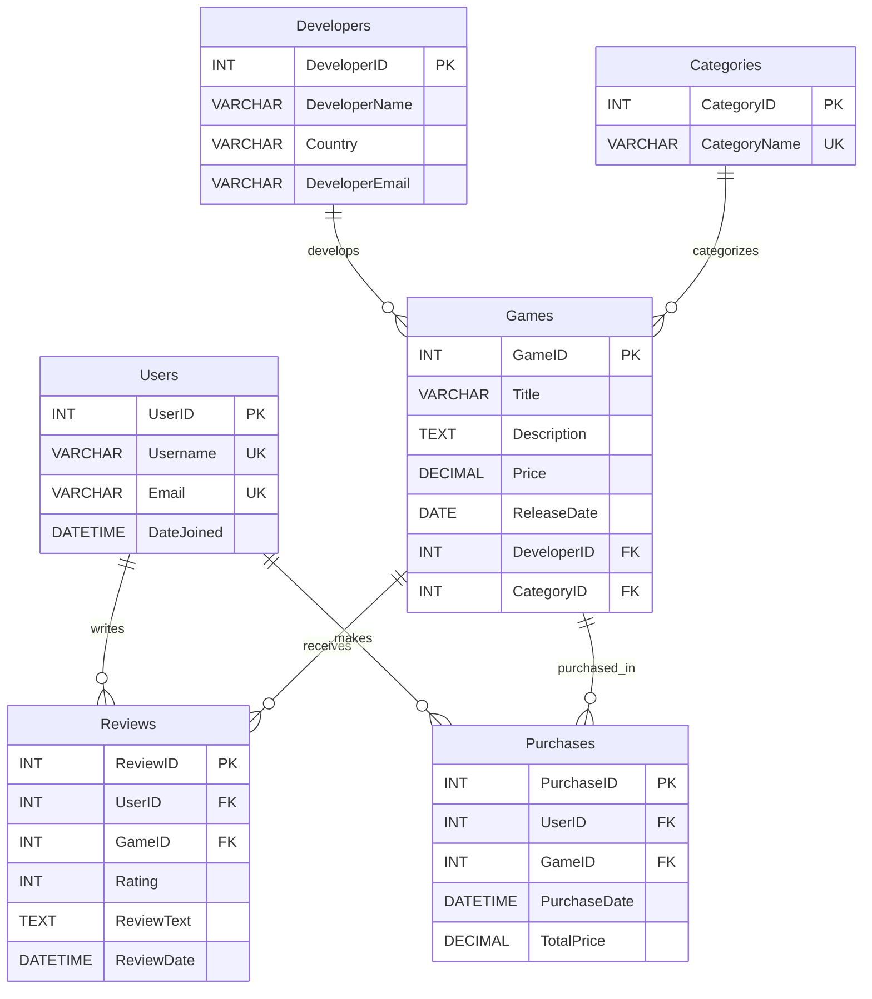

# GameReviewer
A video game store website where users can browse, purchase, and review video games.

## Data Model

  
## Project Check-In 1 — November 9, 2026

GameReviewer is a PHP and MariaDB website where users can browse, purchase, and review video games.

### Current Features
- Apache, PHP, and MariaDB are running.
- PHP connects to MariaDB using PDO.
- Homepage displays games from the database.
- Six database tables with primary and foreign keys.

### Database Schema
The database contains six tables: Users, Games, Developers, Categories, Reviews, and Purchases.

The Mermaid ERD above and [schema.sql](database/schema.sql) represent the current database structure. No structural changes since Week 9.

### Screenshots
- [Database Tables](screenshots/Database.png)
- [Game Records in MariaDB](screenshots/Database_Games.png)
- [Working Homepage and PDO Connection](screenshots/Homepage.png)

### Progress Summary

**Completed:**
- Database setup and PHP connection using PDO.
- Dynamic game display on the homepage.

**Incomplete:**
- User accounts, reviews, purchases, individual game pages, and styling.

**Known Issues / Blockers:**
- No known blockers. Additional CRUD features are needed.

**Next Steps:**
- Implement game pages, user accounts, reviews, purchases, and website styling.